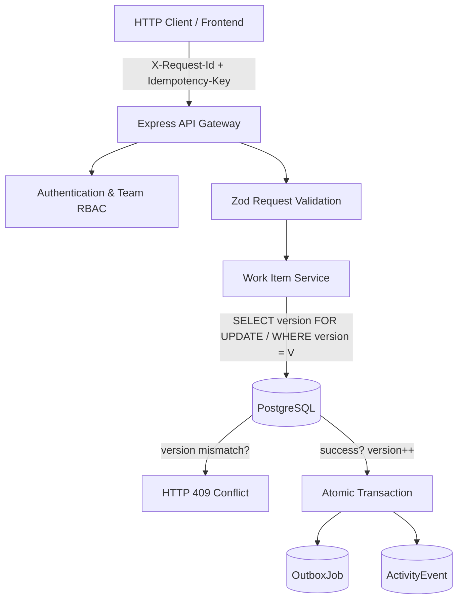

# Newtonite Operations Under Pressure — Architecture

## 1. System Overview

Newtonite Operations Platform is a high-reliability workflow engine designed for incident management, customer support escalations, payment reconciliations, and compliance operations under high concurrent pressure.

### High-Level Monorepo Architecture

```
newtonite-ops/
├── apps/
│   ├── api/                  # Express + TypeScript REST API Engine
│   └── web/                  # React + TypeScript + Vite Dashboard
├── packages/
│   └── shared/               # Shared Domain Enums, Schemas, & API Types
├── prisma/
│   ├── schema.prisma         # Relational Schema with Constraints & Indexes
│   ├── migrations/           # Version-controlled SQL Migrations
│   └── seed.ts               # Deterministic Seed Data Generator
├── tests/
│   ├── integration/          # End-to-End & Integration Test Suites
│   └── fixtures/             # Reusable Test Fixtures
└── docs/                     # Architectural & API Specifications
```

---

## 2. Core Entities & Relational Design

The system models operations around 8 core entities:

1. **User**: Represents team members and system operators. Supports password hashing, active status flags, and system-level administrative privileges (`USER`, `SYSTEM_ADMIN`).
2. **Team**: Functional groups (`Core Operations`, `Platform Engineering`, `Security & Compliance`, `Customer Support`).
3. **Membership**: Join table mapping Users to Teams with explicit scoped roles:
   - `VIEWER`: Read-only access to team work items.
   - `MEMBER`: Create, claim, and work on items within the team.
   - `LEAD`: Approve workflows, reassign items, resolve critical escalations.
   - `ADMIN`: Manage team settings and membership rosters.
   - _Constraint_: Compound unique `[userId, teamId]` prevents duplicate memberships.
4. **WorkItem**: Central operational unit supporting 5 types:
   - `INCIDENT`, `CUSTOMER_ISSUE`, `PAYMENT`, `COMPLIANCE`, `TASK`.
   - Priority levels: `LOW`, `MEDIUM`, `HIGH`, `URGENT`, `CRITICAL`.
   - Status workflow: `BACKLOG` → `TRIAGED` → `IN_PROGRESS` → `IN_REVIEW` → `COMPLETED` / `CANCELLED`.
   - Optimistic Locking: Integer `version` column incremented on every state mutation.
5. **ActivityEvent**: Append-only audit trail capturing every state change (`previousState`, `newState`, `actorId`, `action`, `createdAt`). Never modified or deleted.
6. **Comment**: Chronological contextual discussions tied to a work item.
7. **IdempotencyKey**: Ensures at-most-once execution for mutating API requests under network retries. Captures request hash, status, response headers, and cached payload.
8. **OutboxJob**: Transactional Outbox pattern enabling reliable asynchronous event publishing without distributed two-phase commits.

---

## 3. Concurrency & Reliability Architecture



### 1. Optimistic Locking (`version`)

Every update to a `WorkItem` must provide the expected version (`If-Match` header or payload attribute). If the stored version does not match, the query atomically updates 0 rows and returns `HTTP 409 Conflict`.

### 2. Transactional Outbox Pattern

Domain mutations and background event records are committed in the _same_ PostgreSQL transaction. Asynchronous workers poll `OutboxJob` where `status = 'PENDING' AND nextRetryAt <= NOW()` using bounded retries and exponential backoff.

### 3. Idempotency Guarantees

Clients send an `Idempotency-Key` header with mutation requests. If the key exists:

- If still `PROCESSING`, returns `HTTP 409` or `425 Too Early`.
- If `RESOLVED`, replays the stored status code, headers, and response body without re-executing business logic.

---

## 4. Observability & Security

- **Correlation ID**: Every HTTP transaction is tagged with a UUID `X-Request-Id` for tracing across logs, metrics, and error responses.
- **Redaction**: Structured logger automatically suppresses sensitive fields (`password`, `token`, `secret`, `authorization`, `cookie`).
- **Sanitized Errors**: Operational errors return consistent JSON envelopes; internal stack traces are strictly hidden in production environments.
